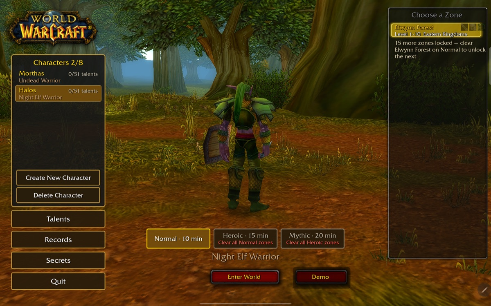
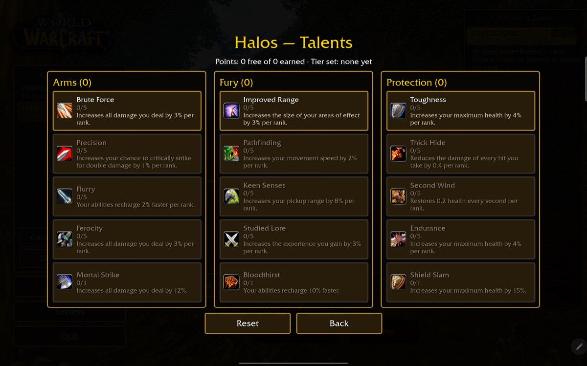
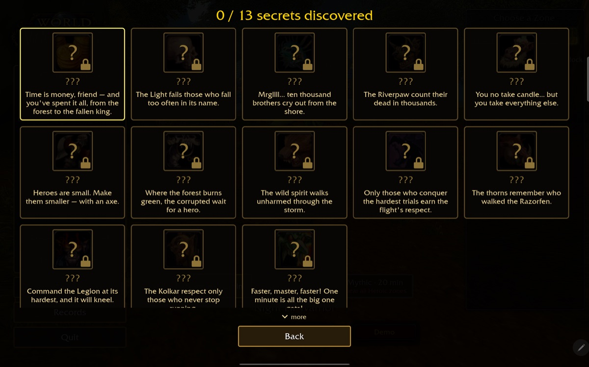
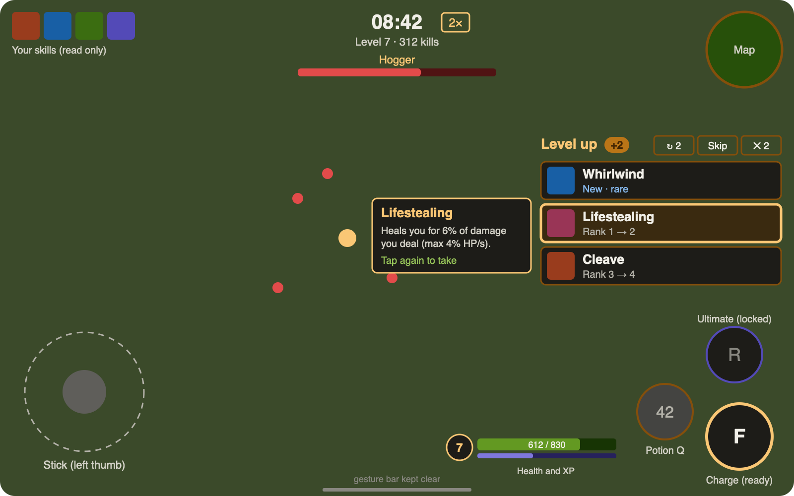

<div align="center">

# Azeroth Survivors: Android edition

**by [Zhalfir](https://github.com/Zhalfir)**

**Android first. iPhone and iPad next.**

A WoW-inspired survivors roguelike, rebuilt to run natively on Android tablets and phones, with
touch controls, new modes and a lot of mobile performance work.

[](LICENSE-MIT)


</div>

> **Based on someone else's game.** *Azeroth Survivors* was designed and made by
> **[Aethus](https://wow.aethus.pl/)**. Play the original in the browser at
> **[wow.aethus.pl](https://wow.aethus.pl/)**. This fork builds on
> [OutThisLife's local build](https://github.com/OutThisLife/azeroth-survivors-re) and the
> [benilla](https://github.com/samwhosung/benilla) engine. Not affiliated with Blizzard Entertainment.
>
> **Where's the code?** The Android work lives on the
> [`mobile-graphics`](https://github.com/Zhalfir/azeroth-survivors-re/tree/mobile-graphics) branch.
> `main` follows the original local build and carries this README.

## Why I'm doing this

I loved *Azeroth Survivors*, and I wanted to play it on my tablet: couch-friendly, with my thumbs, at a
steady frame rate, and fully offline. That turned into a full Android port, and then into adding the things I
wished the game had: harder difficulties, characters that grow, secrets to hunt, and controls built
for touch from the ground up.

This is a personal, non-commercial project, and it's very much a work in progress. I play every
build on a Samsung Galaxy Tab S9+ and tune it from real run logs.

<table>
  <tr>
    <td width="50%"></td>
    <td width="50%"></td>
  </tr>
  <tr>
    <td></td>
    <td></td>
  </tr>
</table>


## What's new in this edition

- **Native Android build** with touch controls: a floating stick, an action-button arc for the right
  thumb, a free camera with a lock that keeps your view, an optional **stick on the right** for
  smaller screens, and the soft keyboard for naming characters.
- **Characters and progression:** up to 8 named characters, generic talent trees (easy to balance) with each class's own Vanilla icons, and records that keep each
  character's full name.
- **Difficulties:** **Normal**, **Heroic** (clear every Normal zone) and **Mythic** (clear every
  Heroic zone, built as an achievement). Their health, damage and crowd multipliers ease in over
  each run.
- **Demo mode:** a bot plays the run for you. It is also what runs the balance tests.
- **2× game speed**, Vampire Survivors-style, from a button by the clock.
- **The thumb HUD:** level-up choices wait in a compact stack by the right thumb **while the game
  keeps running**. Tap once to preview, twice to take. Health and XP sit by the action buttons.
- **Survival tools:**
  - an on-demand **potion** with a cooldown that is weaker on harder difficulties;
  - glowing red **health globes**;
  - **Lifestealing** as a passive;
  - **Warrior block** and **Rogue dodge** built in;
  - a **Charge** that lunges without a target and stuns the pack it hits.
- **Boss frames and nameplates**, with fewer adds while the final boss is up.
- **13 secret races** with cryptic riddles, among them the Goblin, a Skeleton Paladin, the Murloc
  and the Felguard. They are look-only, with Classic-style class limits.
- **Mobile performance work:**
  - a frame cap (30/60/uncapped);
  - SGSR upscaling;
  - a lean plugin set that disables what the survivors mode doesn't need;
  - animation and effect level of detail;
  - an on-device frame-time and GPU meter.
- **Diagnostics:** a per-run combat log (`Diagnostics/runs/*.jsonl`) and crash reports, used to tune
  balance from real runs.

## Where it's going

**Now: Android polish** (in progress)
- [x] Native ARM64 build, touch controls, the thumb HUD with the level-up stack
- [x] Difficulties, characters, talents, records, secret races, Demo mode, 2× speed
- [x] Potion, health globes, Warrior block, Rogue dodge, a reworked Charge
- [ ] Melee balance pass from run logs (Warrior and Rogue first)

**Next: run variety**
- [ ] Reroll, Skip and Banish on level-up
- [ ] The **Soulstone**: a rare boss drop that revives you once
- [ ] About 6 new Vanilla skills per class, plus **evolutions** (two maxed skills merge, such as Whirlwind and
  Sweeping Strikes into Bladestorm)

**Then: the late game**
- [ ] **Ultimates** on each tree's 31-point capstone: one big button with a long cooldown
- [ ] Gear and boss loot, including **secret weapons** such as the Ashbringer

**After that: iPhone and iPad**
- [ ] An iOS port of the same build (Metal, touch, safe areas), so the game runs on iPhone and iPad as well
  as Android

**Long term: my own game**
- [ ] The engine and gameplay code are MIT/Apache licensed. The plan is to take what this project
  teaches me into an original game with its own world, art and sound, built for mobile from day one.

## Build and install on Android

You need [Rust](https://rustup.rs/) with the `aarch64-linux-android` target,
`cargo install cargo-ndk`, the Android SDK command-line tools with build-tools, a platform and the
NDK (`ANDROID_HOME`), **JDK 17** and `adb`. You also need your own WoW 1.12.1 client's `Data`
folder (see [The game data](#the-game-data-not-in-this-repo)).

```bash
git clone -b mobile-graphics https://github.com/Zhalfir/azeroth-survivors-re
cd azeroth-survivors-re
export JAVA_HOME=/path/to/jdk-17
crates/survivors-android/android/build-apk.sh          # → azeroth-survivors.apk (the build is ~6 GB)
crates/survivors-android/android/install.sh /path/to/WoW/Data   # installs + copies the MPQs to the device
```

`APK_FEATURES=dev` adds the on-device GPU frame meter. The data copy goes into the app's own
folder (`/sdcard/Android/data/local.azeroth.survivors/files/Data`), so the app needs no storage
permission.

## Thank you

None of this would exist without:

- **[Aethus](https://wow.aethus.pl/)**, who designed and made *Azeroth Survivors*. Play the original at
  [wow.aethus.pl](https://wow.aethus.pl/).
- **[OutThisLife](https://github.com/OutThisLife/azeroth-survivors-re)**, for the from-source local
  build this fork starts from.
- **[samwhosung/benilla](https://github.com/samwhosung/benilla)**, the from-scratch WoW 1.12.1
  client in Rust, and **[Arnesen/wenilla](https://github.com/Arnesen/wenilla)**, its web and realm fork.
- **[Bevy](https://bevy.org)** and the Rust game-dev community.
- **Blizzard Entertainment**, for World of Warcraft, the game all of this is a love letter to.


---

## The original local build

Everything below describes OutThisLife's desktop and browser build that this fork started from. It still works on `main`.

<table>
  <tr>
    <td width="50%"></td>
    <td width="50%"></td>
  </tr>
  <tr>
    <td></td>
    <td></td>
  </tr>
</table>

### In this build

- **A character-create pick screen** built from the client's own glue art: eight races, both
  genders, every class the race can be, and **sixteen zones**, from the starting zones to
  Naxxramas and the Gates of Ahn'Qiraj. Each zone fights with its own creatures and bosses, taken
  from the zone's real spawns. Your pick is remembered across reloads.
- **Level-up cards** that deal in, tilt toward the cursor and lift on hover. Their WoW item-quality
  colour says how strong a pick is, and each card lists exactly what changes, like
  `Damage 20 » 26` or `Targets 2 » 3`.
- **A class movement spell on F** from level 5, aimed at the cursor: Blink, Charge, Sprint, Dash,
  Fade, Ghost Wolf, Aspect of the Cheetah, Blessing of Freedom, Howl of Terror.
- **A camera you can free:** locked top-down by default with the hero facing the cursor. **C**
  unlocks it to swing and tilt, and the wheel zooms from over the shoulder out to 70 yards.
- A light sharpen-and-colour pass over the picture (**G** toggles it).

## Play it

```bash
git clone https://github.com/OutThisLife/azeroth-survivors-re
cd azeroth-survivors-re
make build     # fetch game data + install toolchain + build the wasm (~5.5 GB download)
make start     # → open http://127.0.0.1:8090/
```

`make build` chains three re-runnable scripts, each skipping what's already done:

| Step | What it does |
| --- | --- |
| `scripts/fetch-data.sh` | downloads the WoW 1.12.1 client and extracts its MPQs |
| `scripts/web-setup.sh` | installs the wasm toolchain (wasi-sdk, wasm-bindgen, binaryen) |
| `scripts/web-build.sh` | builds the client into `web/dist/` |

**Prerequisites:** [Rust](https://rustup.rs/), `make`, `curl`, `unzip`, and a bash shell. On Windows, run everything from Git Bash; PowerShell and cmd can't run the scripts.

Run `make` (or `make help`) to list every target.

## Controls

See [CONTROLS.md](CONTROLS.md). The short version: **WASD** to move, **Space** to jump, **F**
for your class's movement spell, the **mouse wheel** to zoom, **C** to unlock the camera, **Esc**
to pause, **1/2/3** to pick a level-up card.

## The game data (not in this repo)

This repo ships **no Blizzard content** — no art, models, sounds, maps, MPQ contents, or
FrameXML. The game reads a WoW 1.12.1 client's `Data` folder at runtime, which you supply.

`make build` (via `scripts/fetch-data.sh`) downloads the **English WoW 1.12.1 (build 5875)**
client from [archive.org](https://archive.org/details/WoW_1.12.1-5875) (~5.5 GB) and extracts the
MPQs into `wow-data/Data/` (git-ignored, resumable, skipped when already present). Or point at a
client you already have with `--data` / `WOW_DATA`.

### Changing the download source

If the archive.org item moves or you have your own mirror, override the URL without editing
anything:

```bash
make build WOW_DATA_URL=https://your-mirror.example/client.zip
```

Or set it permanently by editing the single clearly-marked `DEFAULT_DATA_URL` line at the top of
`scripts/fetch-data.sh`. Either way the URL must be a direct link to a zip holding the client's
`Data/*.MPQ` files.

## How it's built

The survivors mode is `crates/benilla-app/src/survivors/`, running on two upstream projects:

- [benilla](https://github.com/samwhosung/benilla) — a from-scratch WoW 1.12.1 client.
- [wenilla](https://github.com/Arnesen/wenilla) — benilla compiled to WebAssembly, with a local
  host and realm service.

## Legal

*Azeroth Survivors* is a free fan game by **Aethus**, not affiliated with or endorsed by
Blizzard Entertainment, and it ships no Blizzard game files. The screenshots in `docs/screenshots/`
show World of Warcraft art rendered from a user-supplied client; that art is © Blizzard
Entertainment. World of Warcraft is a trademark of Blizzard Entertainment, Inc. The engine code in
this repository is licensed under
[MIT](LICENSE-MIT) or [Apache 2.0](LICENSE-APACHE), at your option; the vendored components under
`third_party/` keep their own upstream licenses.
